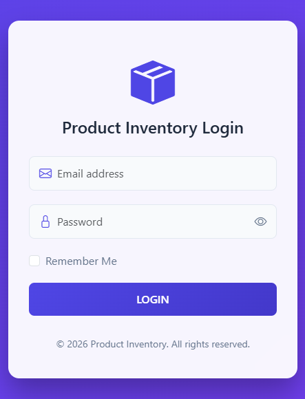
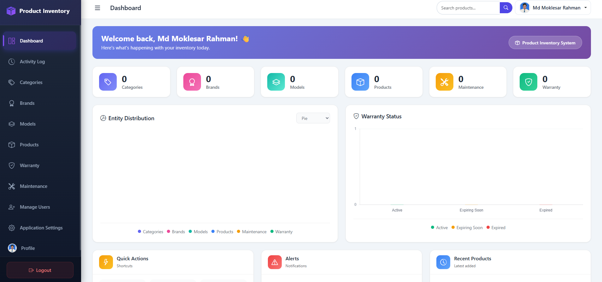
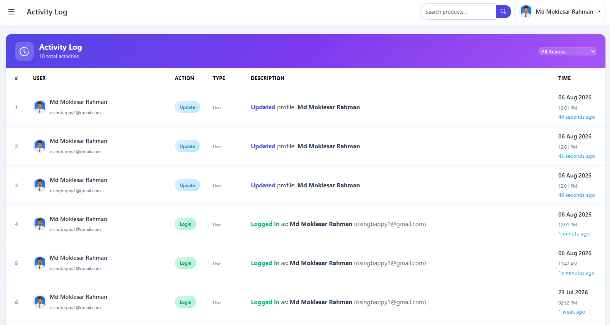
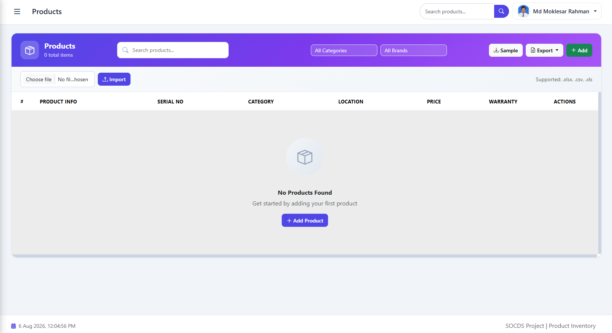
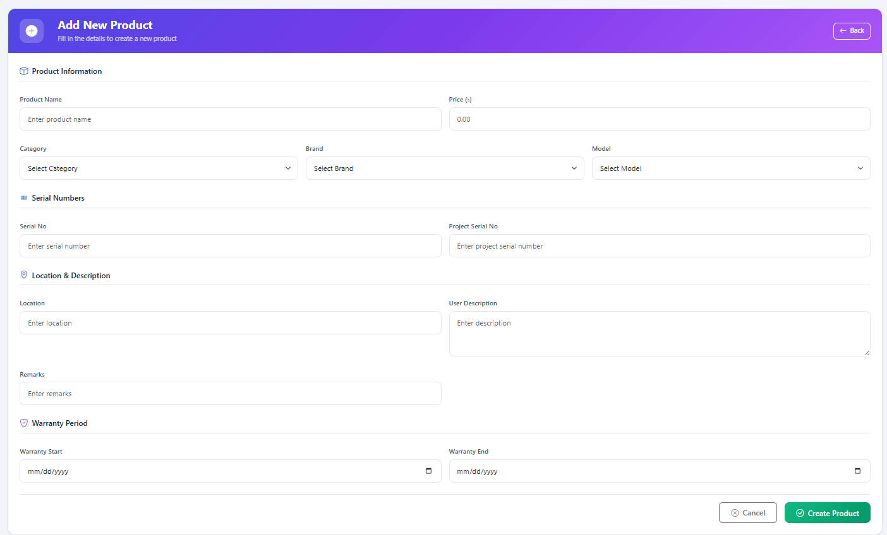
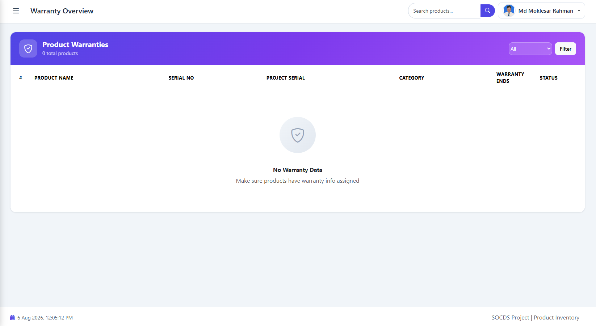
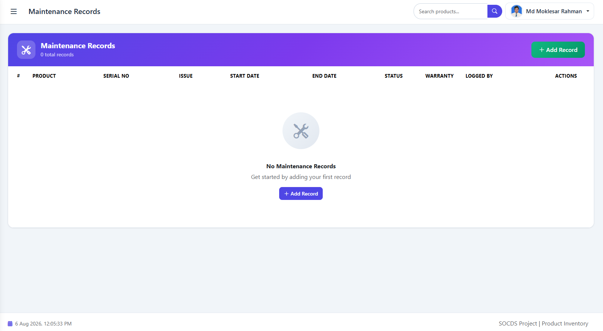
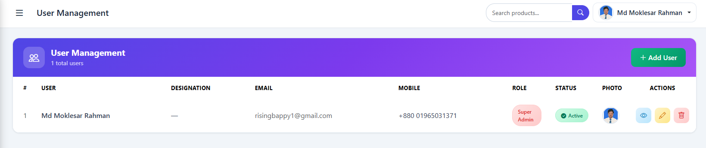
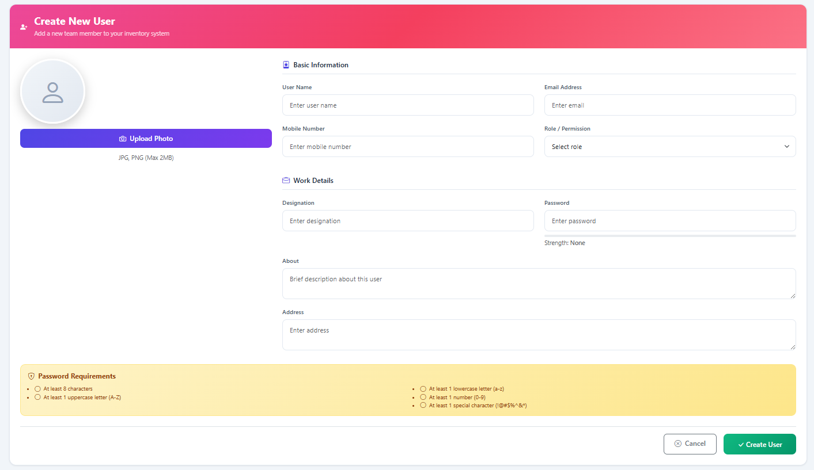
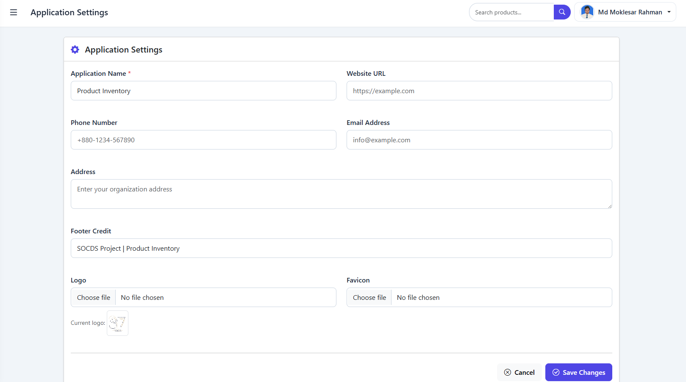

[](CHANGELOG.md)
[](docs/screenshots/README.md)

🔗 [Live Demo](https://md-moklesar-rahman-bappy.github.io/product_inventory/)

# 🧿 Equipment Inventory Management System Dashboard

A vibrant, responsive Laravel application for managing products with advanced CRUD operations, dashboard-level UI polish, and robust backend logic.

---

## 📑 Table of Contents
- [🧿 Equipment Inventory Management System Dashboard](#-equipment-inventory-management-system-dashboard)
  - [📑 Table of Contents](#-table-of-contents)
  - [🚀 Features](#-features)
  - [🛠️ Tech Stack](#️-tech-stack)
  - [📁 Folder Structure](#-folder-structure)
  - [⚙️ Setup Instructions](#️-setup-instructions)
  - [📸 Screenshots](#-screenshots)
  - [📖 Documentation](#-documentation)

---

## 🚀 Features
- 🧩 Modular CRUD for Products, Brands, Categories, and Models  
- 🔍 Search by Serial Number with pagination and highlight  
- 🎨 Beautiful dashboard UI with gradient headers, badges, and icons  
- 📦 Product creation with category, brand, model, serials, and remarks  
- 🛡️ Form validation with feedback and empty state visuals  
- 🧠 Blade components and DRY structure for maintainability  

---

## 🛠️ Tech Stack
| Layer        | Tools & Frameworks               |
|-------------|----------------------------------|
| Backend      | Laravel 12.0+, Eloquent ORM      |
| Package      | maatwebsite/excel `^3.1`         |
| PHP Version  | `^8.2`                           |
| Database     | MySQL / MariaDB 10.4+ (`utf8mb4`) |
| Testing      | Pest `^3.8`, PHPUnit `11.5.33`    |
| Frontend     | Blade, Bootstrap 5               |

## 🔒 Security Practices
- Import/export routes protected by `auth` and `isAdmin` middleware.
- No secrets committed (`.env` excluded).
- `APP_DEBUG=false` in production.
- Database uses `utf8mb4` charset with `utf8mb4_unicode_ci` collation.
- Position field handled as text (not numeric) to prevent data loss.

---

## 📁 Folder Structure
├── app/ │   ├── Models/ │   ├── Http/Controllers/ │   └── Requests/ ├── resources/ │   ├── views/ │   │   ├── products/ │   │   ├── brands/ │   │   ├── categories/ │   │   └── models/ │   └── layouts/ ├── routes/ │   └── web.php


---

## ⚙️ Setup Instructions
1. **Clone the repo**
   ```bash
   git clone https://github.com/your-username/product-inventory-dashboard.git
   cd product-inventory-dashboard
   ```

2. **Install dependencies**
   ```bash
   composer install
   npm install && npm run dev
   ```

3. **Environment setup**
   ```bash
   cp .env.example .env
   php artisan key:generate
   ```

4. **Database migration**
   ```bash
   php artisan migrate
   ```

5. **Run the server**
   ```bash
   php artisan serve
   ```

6. **Admin Account**
   
   During installation, you will be prompted to create your own super admin account with a custom name, email, and password. No default or hardcoded credentials are used.

🔍 Search Functionality
- Search by serial number from the product index page
- Pagination retains search query
- Matching serials are highlighted using <mark>
- Clean UI with instant feedback

## 📸 Screenshots






















## 📖 Documentation
- [UI Guidelines](docs/ui-guidelines.md)
- [Architecture](docs/architecture.md)
- [Roadmap](docs/roadmap.md)
- [Changelog](docs/changelog.md)
- [User Guide](docs/USER_GUIDE.md)
- [Import Template Guide](docs/IMPORT_TEMPLATE_GUIDE.md)
- [Installation](docs/INSTALLATION.md)
- [Upgrade](docs/UPGRADE.md)
- [Backup and Restore](docs/BACKUP_AND_RESTORE.md)
- [Troubleshooting](docs/TROUBLESHOOTING.md)
- [Release Checklist](docs/RELEASE_CHECKLIST.md)
- [Technical Import/Export](docs/TECHNICAL_IMPORT_EXPORT.md)

✨ UI/UX Highlights
- Gradient buttons with hover effects
- Font Awesome icons for actions
- Tooltips for clarity
- Empty states with illustrations and messages
- Consistent color palette across modules
- Responsive layout for desktop and mobile

## 📦 Import / Export Architecture
- Central mapping: `App\Services\ProductRowMapper` defines the canonical 12-column product schema.
- All exports use the same mapping (`ProductExport`, `CategoryProductExport`, `BrandProductExport`, `AssetModelProductExport`).
- Import validates headings, dates, prices, duplicates, and lookup values.

## 🧾 Canonical Product Schema (12 Columns)
1. `product_name`  2. `price`  3. `category`  4. `brand`  5. `model`  6. `serial_no`  7. `project_serial_no`  8. `position`  9. `user_description`  10. `remarks`  11. `warranty_start`  12. `warranty_end`

## 🌐 Unicode Policy
- All text fields support Bangla (UTF-8).
- Database uses `utf8mb4` charset with `utf8mb4_unicode_ci` collation.
- `.xlsx` is the recommended import/export format.
- CSV supported with UTF-8 BOM.

🧠 Developer Notes
- Uses Laravel resourceful routing and route model binding
- Form requests handle validation cleanly
- Blade components for buttons, alerts, and form inputs
- Foreign key constraints enforced in migrations
- Modular design for scalability and maintainability
- GitHub Actions workflow runs tests automatically on push/PR
- Releases are automated via tags and changelog integration

🙌 Credits
Crafted with ❤️ by Md Moklesar Rahman
Laravel architect & UI/UX designer
Focused on beauty, clarity, and backend precision.
📧 Email: md.moklasarrahmanbappy@gmail.com
📧 Email: risingbappy1@gmail.com

📜 License
This project is open-source under the [MIT License](LICENSE.md).

🤝 Contributing
Please see [CONTRIBUTING.md](CONTRIBUTING.md) for guidelines.
- Bug reports: use the [Bug Report Template](.github/ISSUE_TEMPLATE/bug_report.md)
- Feature requests: use the [Feature Request Template](.github/ISSUE_TEMPLATE/feature_request.md)
- Pull requests: follow the [PR Template](.github/pull_request_template.md)

📬 Contact
For feedback, suggestions, or collaboration, feel free to reach out via email or GitHub.

